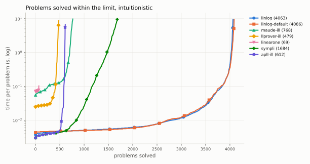
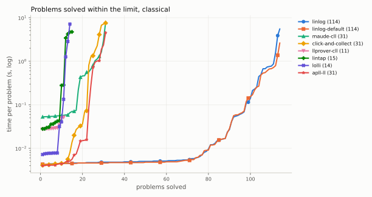

# linlog beside the other provers

What each prover of linear logic we could find can do, and what each of
those that run in batch decides on the same problems under the same
limits. Every cell of the matrix was read from the tool's own source or
page on 2026-10-15; the numbers come from one night on one machine, and
`bench/comparison.sh` reproduces them on any machine with Nix.

## The tools

| | linlog | Maude LL prover | llprover | linTAP | Click & coLLecT | Sympli | LinearOne | lolli | APLL | Proof Net Calculator |
|---|---|---|---|---|---|---|---|---|---|---|
| authors | this repository | Olarte et al. | Tamura | Mantel, Otten | Callies, Laurent | Chaudhuri | Moot | ibrahimcesar | Wu | Matsuoka |
| fragments | MLL to full LL, propositional, units | full LL and full ILL, propositional, units | full LL, first order | MLL with units and `?` | full LL, propositional, units | ILL: `! ⊗ & ⊕ ⊸ 1 0 ⊤` | MILL (`⊗ ⊸`), first order | MLL, MALL, MELL with units | full LL and full ILL, propositional, units | unit-free MLL |
| modes | classical, intuitionistic, affine, Mix | classical, intuitionistic | classical, intuitionistic | classical | classical | intuitionistic | intuitionistic | classical | classical, intuitionistic | — |
| automatic | ✓ | ✓ | ✓ | ✓ | ✓ (and interactive) | ✓ | ✓ | ✓ (and a REPL) | ✓ (backward search or inverse method) | ✗ (net checks and enumeration) |
| interactive | ✓ (`linlog interact`) | ✗ | ✗ | ✗ | ✓ (web) | ✗ | ✗ | REPL only | ✗ | GUI for drawing nets |
| decides unprovability | ✓ (an exhaustive search or a refutation) | without `!`; with `!` up to a copy bound | without exponentials; with them up to a threshold | without `?` | ✓ when the search is exhaustive | ✓ (saturation) | ✓ | ✗ (a depth limit) | ✓ unless its bound of contractions is met | — |
| proofs output | ✓ (terms, derivations) | ✓ (LaTeX tree, ILL) | ✓ (ASCII, LaTeX, Prolog term) | ✗ (yes or no) | ✓ | ✓ (proof terms) | ✓ (λ-terms, LaTeX) | ✓ (tree, λ-term) | ✓ (its proof trees, LaTeX) | nets |
| proof nets | ✓ (MLL, search and criterion) | ✗ | ✓ (an output style) | ✗ | ✗ | ✗ | ✓ (TikZ) | ✗ | ✗ | ✓ |
| checker | ✓ (independent, every proof) | ✗ | ✗ | ✗ | unverified | ✓ (its own validation) | unverified | ✗ | ✗ | ✓ (correctness criteria) |
| certificates | ✓ (Rocq, NanoYalla) | ✗ | ✗ | ✗ | ✓ (Coq, NanoYalla) | ✗ | ✗ | ✗ | ✓ (Coq, Yalla) | ✗ |
| exports | LaTeX, Typst, SVG, PNG, PDF, Rocq, JSON | LaTeX | LaTeX | — | LaTeX, PDF, PNG, ASCII, Coq | — | LaTeX, TikZ | LaTeX, DOT, SVG | LaTeX, Coq | — |
| limits | time, memory, copies, recursion, work | copy bound | threshold of contractions | — | 3 s of CPU (fixed) | — | — | depth | bound of contractions | — |
| threads | one, or a pool (`--jobs`) | one | one | one | one | one | one | one | one | unverified |
| input formats | text, JSON, LLTP, `.spec`, TPTP, batch files | Maude terms (a sed script for LLTP) | its sequents | Prolog terms | its sequents | its scripts | Prolog terms | its sequents | its sequents, LLTP | its formulas |
| licence | EUPL-1.2 | none stated | none formal ("freely distribute or modify") | GPL, no version | LGPL-2.1 | BSD-2-Clause | LGPL-2.1 | MIT | none stated | none stated |
| last activity | 2026-10 | 2020-11-03 | 2020-12-30 (SWI port) | 2012-03-30 (file) | 2025-04-07 | 2018-07-27 | 2026-06-11 | 2025-12-05 | 2019-04-29 | 2023-09-21 (page) |
| runs here in batch | ✓ | ✓ (Maude 3.5.1) | ✓ (SWI-Prolog 10) | ✓ (a driver of ours) | ✓ (a driver of ours) | ✓ (a patch for MLton) | ✓ (a driver of ours) | ✓ | ✓ (OCaml 4.14, native) | ✗ |

Sources, all read on 2026-10-15:

- **linlog**: README, "What exists and what is planned"; the crate's
  documentation, "Features", and the dispatch table on `Engine`; `linlog
  prove --help` for the limits and input formats.
- **Maude LL prover**: github.com/carlosolarte/Linear-Logic-Prover-in-Maude
  at `5e1da7f` (its README, `maude-prover/*.maude`, and
  `utils/exec-ILLTP-flat-file.sh`, the script of its LLTP runs: `solve(5,
  …)`); the LLTP library's status files are its runs of 2018.
- **llprover**: cspsat.gitlab.io/llprover, `llprover.pl` (version 2.0,
  the SWI port of 2020-12-30, lines 5, 57–63, 120–122, 381) and
  `guide.pdf` (sections 1, 3 and 4).
- **linTAP**: leancop.de/lintap and `programs/lintap.pl` (version 1.08e,
  its header and `pp/2`); its `prove/1` raises the exponential limit for
  ever on a formula it cannot prove, so the driver of this repository
  replays its search under each limit in turn.
- **Click & coLLecT**: github.com/ComputerAidedLL/click-and-collect at
  `6b1c25f` (`LICENSE`, `ll_lexer.mll`, `ll_parser.mly`,
  `focused_proof.ml` lines 470–484, `export_as_coq.ml`, `main.ml`).
- **Sympli**: github.com/chaudhuri/sympli at `50e76a6` (`LICENSE`,
  README, `Engine2_Focusing`, `Proof.test`).
- **LinearOne**: github.com/RichardMoot/LinearOne at `d9379a5` (`LICENSE`,
  `mill1.pl` lines 672–709, `first_proof/3`); whether it checks its
  proofs is unverified.
- **lolli**: github.com/ibrahimcesar/lolli at `cb09efc` (`LICENSE`,
  README, which calls it "not suitable for batch processing", and the
  command's `prove --depth`).
- **APLL**: github.com/wujuihsuan2016/LL_prover at `c55f59d` (its
  README, which the LLTP library's README names beside the Maude prover,
  and `src/prover.ml`, `foc_ill_bwd.ml` lines 307–320: `N` only when the
  bound was never met); no licence file.
- **Proof Net Calculator**: staff.aist.go.jp/s-matsuoka/PNCalculator
  (page of 2023-09-21) and `ProofNetCalculator-Ver0.0.12.zip`
  (2021-07-04): a Scala library and GUI that checks, transforms and
  enumerates unit-free MLL nets, no prover of a given sequent, built with
  sbt from the network. It is no column of the tables.

Not provers in this sense: Celf, LolliMon and Lolli (logic programming
over fragments of ILL), Grail (categorial parsing), Yalla and the Lean
and Isabelle formalisations (no automation).

## How the comparison is made

- **The problems**: the LLTP library's intuitionistic problems (`ILL/`,
  4 495 of them, 3 137 of them Petri nets) and classical ones (`CLL/`,
  17), qcover's 176 coverability problems (intuitionistic affine) and
  the generated families of `linlog-bench families` at their default
  sizes, with their known verdicts where the source states one.
- **Every tool runs every problem of its fragment and mode**, translated
  from linlog's reading of the problem into the tool's own syntax by
  `bench/src/translate.rs`, which prints through the library's public
  walk over a formula (atoms renamed `p0`, `p1`, …, every compound
  formula in parentheses). A problem outside a tool's fragment or mode
  is counted apart and not run; no tool but linlog has an affine or a
  Mix mode, so the coverability problems and the Mix family are
  linlog's alone, and a classical tool never gets an intuitionistic
  problem. linlog reads the LLTP and `.spec` files itself. The
  translation's time is stated per tool and is not part of a run.
- **Every tool in its own documented configuration**: APLL's backward
  search under its default bound of 3 contractions, the Maude prover's
  ILL search with the copy bound 5 of its own LLTP script, llprover's
  default threshold 5, lolli's default depth 100, linTAP's search with
  its exponential limit raised without end as its `prove/1` does, Click &
  coLLecT's prover as its web server calls it with its limit of CPU time
  set to the run's, Sympli's inverse method on `(⊗Γ) ⊸ A`. A tool's
  bounded failure is `unknown`, never `unprovable`.
- **linlog in two columns**: `linlog`, the command on one thread
  (`--deterministic`), the main column, since every other tool is
  sequential; and `linlog-default`, the command as a user runs it (one
  thread, then a pool beside it), on four cores. Those four are the
  machine's low-power cluster (3.7 GHz, no share of the last-level
  cache), slower than the efficiency cores (4.0 GHz) every sequential
  tool and linlog's own one-thread column ran on, so the default column
  is measured on slower cores than the others.
- **Measured with BenchExec** (`runexec` 3.27, cgroups v2): each run is a
  process of its own under the same limits, wall time of the whole
  process (its start, its parse and, for linlog, the check of its proof
  included), CPU time and the cgroup's peak memory. linlog gets
  `--timeout` and `--memory-limit` equal to the limits BenchExec
  enforces; a run the cgroup ends for memory is that tool's, linlog's
  included.
- **The time limit, 10 s, is what one night allows** for every tool on
  every problem, and it disadvantages a tool that answers late: the
  tables list every answer that came after it, the kill a second later
  bounds what that list can show, and the Maude prover's own results of
  2018 in the LLTP library stand beside tonight's as a reference.
- **The ranking is the number of problems solved within the limit**, a
  verdict of proved or unprovable in time, as CASC and the SAT
  competition rank; times are in the figures, never averaged into
  ratios.
- **Contradictions are listed**, between two tools or against a known
  verdict, each verdict marked checked or not: linlog checks every proof
  it reports with a checker that shares no code with its search, Sympli
  validates its own; no `unprovable` is checked, linlog's included.

Reproduce, on any Linux machine with Nix and a systemd user session:

```sh
bench/comparison.sh --out comparison --cores 0,1,2,3 --default-cores 4-7 --timeout 10
```

The CI workflow `Comparison` runs the same script on GitHub's runners in
ten shards (`workflow_dispatch`) and uploads the rows, tables and figures.

## Results

One run on 2026-10-15 on an Intel Core Ultra X9 388H (16 cores, 64 GB,
Linux 7.2.9): the sequential tools and linlog's one-thread column each
on one efficiency core (4.0 GHz, cores 6–11, six streams side by side),
linlog's default on the four low-power cores (12–15, 3.7 GHz), every run
under 10 s and 4 GiB, measured by BenchExec 3.27. linlog was built from
commit 60226b2c (signed since as 8a06dd9c, the same tree), every other
tool at the version the flake pins (`comparison/2026-10-15/*.env.json`
records each, with the command lines). The rows are
`comparison/2026-10-15/runs.csv` (62 543 runs), the tables
`comparison/2026-10-15/ranking.md` (`linlog-bench ranking runs.csv`), the
figures `comparison/2026-10-15/figures/` (`bench/plots.py`).

### Solved within 10 s

| tool | solved | proved | unprovable | wrong | ended at the limit | out of memory | the tool's bound | error | outside its fragment |
|---|---|---|---|---|---|---|---|---|---|
| linlog, default (4 low-power cores) | 4 204 | 3 907 | 297 | 0 | 545 | 3 | 59 | 0 | 0 |
| **linlog, one thread** | **4 181** | 3 899 | 282 | 0 | 571 | 0 | 59 | 0 | 0 |
| Sympli | 1 684 | 1 439 | 245 | 0 | 1 935 | 876 | 0 | 0 | 316 |
| Maude, ILL | 768 | 742 | 26 | 0 | 2 940 | 71 | 700 | 16 | 316 |
| APLL, ILL | 612 | 544 | 68 | **1 296** | 2 015 | 20 | 412 | 140 | 316 |
| llprover, ILL | 479 | 453 | 26 | 0 | 3 857 | 0 | 19 | 140 | 316 |
| LinearOne | 69 | 46 | 23 | 0 | 0 | 0 | 0 | 0 | 4 742 |
| APLL, LL | 31 | 22 | 9 | **12** | 78 | 0 | 13 | 0 | 4 677 |
| Click & coLLecT | 31 | 23 | 8 | **12** | 91 | 0 | 0 | 0 | 4 677 |
| Maude, LL | 31 | 20 | 11 | 0 | 82 | 21 | 0 | 0 | 4 677 |
| linTAP | 15 | 14 | 1 | 0 | 37 | 21 | 0 | 0 | 4 738 |
| lolli | 14 | 14 | 0 | 0 | 54 | 35 | 23 | 6 | 4 679 |
| llprover, LL | 11 | 10 | 1 | 0 | 123 | 0 | 0 | 0 | 4 677 |

4 811 problems. "Ended at the limit" includes the answers that came
after 10 s and before the kill a second later (late: 38 of the Maude
prover's, 14 of Sympli's, 5 of llprover's; `ranking.md` lists them).
An error is mostly a stack overflow on a deep formula (APLL 140,
llprover 129 of its 140).

| problems | linlog | linlog, default | Maude | llprover | Sympli | APLL | LinearOne | Click & coLLecT | linTAP | lolli |
|---|---|---|---|---|---|---|---|---|---|---|
| LLTP intuitionistic, 1 358 | 829 | 852 | 613 | 479 | **873** | 548 | 69 / 69 | – | – | – |
| LLTP Petri nets, 3 137 | **3 072** | 3 072 | 155 | 0 | 811 | 64 | – | – | – | – |
| LLTP classical, 17 | **17** | 17 | 12 | 10 | – | 13 | – | 15 | 2 / 6 | 7 |
| qcover, 176 (intuitionistic affine) | **162** | 162 | – | – | – | – | – | – | – | – |
| generated families, 123 | **101** | 101 | 19 / 117 | 1 / 117 | – | 18 / 117 | – | 16 / 117 | 13 / 67 | 7 / 115 |

A dash is a set outside the tool's fragment or mode; `n / m` where the
tool covers only `m` of the set.

### Where linlog loses

- **Sympli solves 132 intuitionistic LLTP problems that linlog on one
  thread does not**: 122 refutations (unchecked), most of them in the
  SYJ collections (96), where Sympli's inverse method saturates in
  milliseconds what linlog's backward search leaves at its time limit or
  its copy bound, and 10 proofs (SYJ, call-by-name). On the
  intuitionistic problems other than Petri nets Sympli solves 873
  against linlog's 829.
- **linlog's default solves 23 that its one thread does not** (it races
  a second search on a pool), and ends 3 runs at the 4 GiB cgroup limit
  (SYJ206+1.020, SYJ212+1.020 in two translations): the process grew
  past the 4 GiB that linlog's own memory bound allows, so something it
  allocates there is not counted against the bound (not yet found).
  These count as linlog's, out of memory.
- **APLL's ILL search refutes 31 Petri nets that linlog does not
  decide**, against their headers (Theorem). Since APLL refutes 1 296
  nets that linlog proves with checked proofs (below), these 31 are
  most likely wrong too; they count as solved, since nothing here
  proves them.

### Wrong answers

linlog gave none: every proof it reported passed its checker, and no
tool proves a sequent linlog refutes. Wrong, and not counted as solved:

- **APLL (ILL)** refutes 1 296 Petri nets that linlog proves with checked
  proofs; APLL answers the same on the library's own files read by its
  own LLTP reader (`-lltp`), so the translation is not the cause. Its
  `N` is meant to come only from a search that never met its bound of 3
  contractions.
- **APLL (LL) and Click & coLLecT** each refute the same 12 generated
  classical MLL sequents (`wide-m*` at 256 literals and more, and
  `partition-yes` at 24 and 28), provable by construction; 10 of them
  linlog proves with checked proofs, also from the very file Click &
  coLLecT was given. Click & coLLecT's `NOT PROVABLE` comes only from a
  search it calls exhaustive; the two share the structure of their
  focused search.

### The library's headers

29 LLTP files have a header that linlog's answers contradict (checked
proofs of 9 marked Non-Theorem, refutations of 20 marked Theorem; most of
them known from linlog's earlier baselines), and Sympli refutes 18
more marked Theorem that linlog leaves undecided. 15 of those 18 have a
classical countermodel once linearity is forgotten (`!` erased, `⊸` as
implication, `0` as falsity), so their headers are wrong and Sympli is
right; KLE075 in its three translations has none and stays open. Such
verdicts count as solved and are listed in `ranking.md`.

### What the 10 s limit costs a slower tool

The Maude prover's own results in the LLTP library, at five minutes on a
2 GHz virtual CPU (the ILLTP paper, arXiv 1904.06850, Table 1, whose
counts the status files match), beside its results here at 10 s. The
library has changed since: the problem counts differ in some sets.

| set | problems then | Maude 2018, 300 s | Maude here, 10 s | linlog here, 10 s |
|---|---|---|---|---|
| ILLTP-SYJ-01 | 248 | 39 | 30 of 252 | 56 |
| ILLTP-SYJ-cbn | 248 | 45 | 30 of 252 | 106 |
| ILLTP-SYJ-cbv | 248 | 39 | 33 of 252 | 99 |
| ILLTP-SYN-01, -cbn, -cbv | 20 each | 11 each | 8 of 19 each | 16 each |
| KLE-01 | 88 | 77 | 74 of 88 | 79 |
| KLE-cbn | 88 | 76 | 74 of 88 | 83 |
| KLE-cbv | 88 | 79 | 74 of 88 | 81 |
| KLE-IMP-CONJ | 271 | 271 (limit not stated) | 222 of 222 | 222 |
| ILLTP-LCL (three) | 2 each | 0 | 0 | 3 of 6 |

The 10 s limit is what one night allows for every tool on every
problem; a longer one on the problems no tool solved is open.

### Figures





Scatter plots of linlog on one thread against each tool, one point per
problem both cover (a run not solved at the limit's line), are in
`comparison/2026-10-15/figures/scatter-*.svg`.
